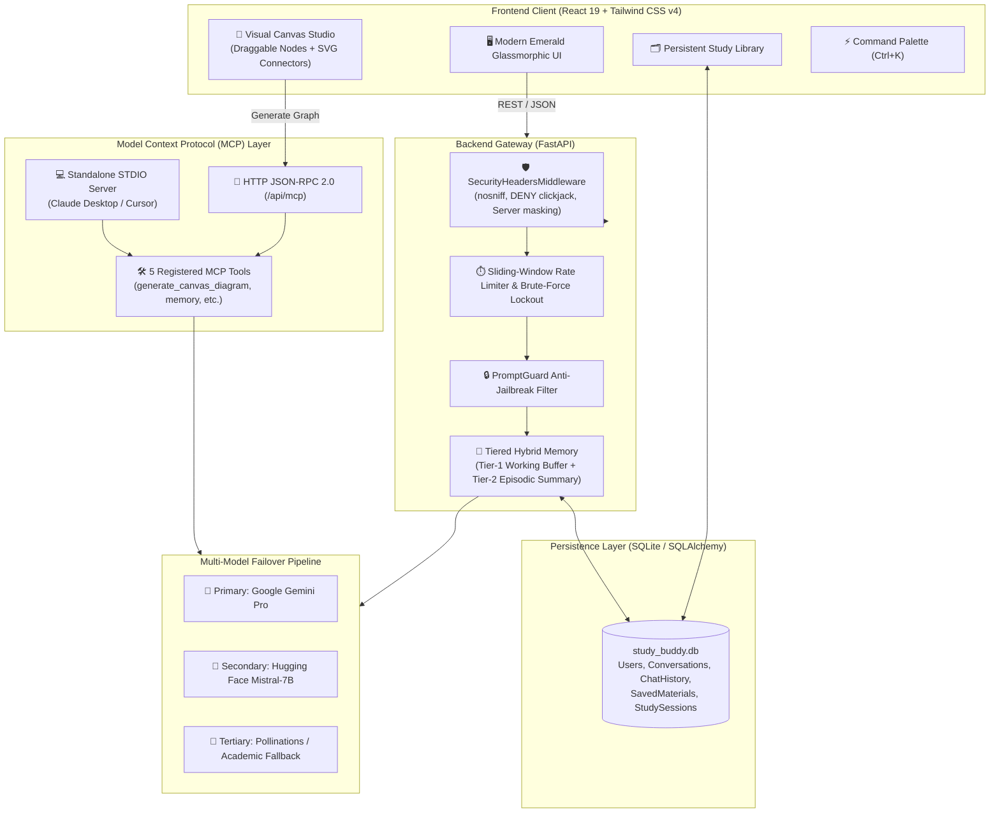

# 🎓 AI Study Buddy (Developer & MCP Edition)
> **Your Intelligent, Model Context Protocol (MCP) Powered Learning Companion & Visual Architecture Studio.**
> *A full-stack modern learning platform featuring Hybrid Memory Architecture, interactive Canvas Whiteboard modeling with Excalidraw export, high-fidelity Mermaid vector diagrams, spaced repetition, audio synthesis, and an enterprise safety suite.*

[](https://fastapi.tiangolo.com/)
[](https://react.dev/)
[](https://tailwindcss.com/)
[](https://modelcontextprotocol.io/)
[](https://mermaid.js.org/)
[](https://excalidraw.com/)
[](https://pyjwt.readthedocs.io/)
[](LICENSE)

---

## 🏛️ System Architecture



---

## 💎 Key Features & Capabilities

### 1. 🔌 Model Context Protocol (MCP) Integration
- **Standards Compliant JSON-RPC 2.0**: Connects external AI tools (Claude Desktop, Cursor IDE, Obsidian Canvas, Antigravity) to Study Buddy.
- **5 Registered MCP Tools**:
  1. `generate_canvas_diagram`: Produces multi-tier visual nodes, geometry, and Excalidraw-compatible element arrays.
  2. `export_to_canvas_json`: Converts raw notes and concept hierarchies into visual canvas elements.
  3. `generate_mermaid_spec`: Generates validated Mermaid flowchart and sequence definitions.
  4. `query_study_memory`: Exposes SQLite hybrid memory context to external tools.
  5. `create_study_flashcards`: Generates active recall study cards.
- **Standalone STDIO Runner**: Launch `python backend/mcp_server.py` to hook into any local MCP client configuration.

### 2. 🎨 Visual Canvas Studio (`/canvas`)
- **Infinite Interactive Canvas**: Smooth pan, zoom (40% to 220%), fit view, and draggable nodes.
- **Dynamic Bezier Curves**: Real-time curved SVG arrows connecting components that automatically re-route when nodes are moved.
- **Excalidraw Integration**: 1-click **"Copy Excalidraw"** exports ready-to-paste JSON compatible with [excalidraw.com](https://excalidraw.com).
- **Mermaid Vector Synchronizer**: View and copy synchronized Mermaid.js code for any canvas graph.
- **Export to SVG**: Download high-resolution vector diagrams.

### 3. 🧠 Tiered Hybrid Memory Architecture
- **Tier-1 (Short-Term Working Buffer)**: Retains recent verbatim dialogue turns for sharp immediate conversational context.
- **Tier-2 (Episodic Long-Term Summary)**: Automatically condenses earlier turns when discussions exceed 10 messages, preserving conceptual points without token bloat.
- **Live Memory Inspector**: Real-time modal in chat showing active buffer counts and long-term summary status.

### 4. 🗂️ Persistent Study Library (`/library`)
- **Central Knowledge Hub**: Save summaries, canvas models, quizzes, and flashcard decks into SQLite.
- **Filtering & Search**: Filter by category (`Summaries`, `Canvas Diagrams`, `Flashcards`, `Quizzes`), search by title/topic, and star favorites.
- **Full-Note Inspection Modal**: Re-open saved study guides and diagrams anytime.

### 5. ⚡ Global Command Palette (`Ctrl+K` / `⌘K`)
- Spotlight overlay accessible anywhere in the app via `Ctrl+K` or header search button.
- Instant keyboard navigation to any study tool or quick action (`+ New Chat`, `Open Canvas Studio`, `Inspect MCP Server`).

### 6. 🔊 Audio Speech Synthesis (TTS) & Spaced Repetition
- **Summarizer TTS**: Web Speech API audio player reads summaries aloud with live audio controls.
- **Spaced Repetition Flashcards**: Anki/Leitner-style self-grading (🔴 Hard, 🟡 Good, 🟢 Mastered) with deck mastery metrics and keyboard hotkeys.

### 7. 🛡️ Enterprise Safety & Security Suite
- **Sliding-Window Rate Limiter**: 60 req/min per client IP with automatic brute-force lockout on repeated login failures.
- **PromptGuard Jailbreak Defense**: Regex heuristic filter intercepting prompt injection, role confusion, and system prompt leakage attempts.
- **Security Headers Middleware**: Enforces `X-Content-Type-Options: nosniff`, `X-Frame-Options: DENY`, `Referrer-Policy`, and server technology masking (`Server: StudyBuddy-Gateway`).
- **5-Checkpoint Password Meter**: Enforces enterprise password complexity.

---

## 📁 Project Directory Organization

```
Internship_project_study_buddy/
├── backend/
│   ├── ai_service.py         # Multi-model inference (Gemini, HF, fallback templates)
│   ├── analytics.py          # Session charting & progress calculation
│   ├── auth.py               # Bcrypt password hashing & JWT token verification
│   ├── database.py           # SQLAlchemy SQLite engine & session factory
│   ├── main.py               # FastAPI gateway, REST routes, and MCP endpoints
│   ├── maps.py               # Concept graph network analysis
│   ├── mcp_server.py         # Standalone STDIO Model Context Protocol server
│   ├── mcp_service.py        # MCP JSON-RPC 2.0 processor & tool registry
│   ├── models.py             # SQLite ORM models (Conversations, Materials, Users)
│   ├── requirements.txt      # Python dependencies (FastAPI, MCP, SQLAlchemy, etc.)
│   └── security.py           # Rate limiting, PromptGuard, and security middleware
├── src/
│   ├── components/
│   │   ├── ChatInterface.jsx     # Multi-session chat with hybrid memory inspector
│   │   ├── CommandPalette.jsx    # Global Ctrl+K spotlight navigation
│   │   ├── FeatureGrid.jsx       # Landing page feature matrix
│   │   ├── Header.jsx            # Glassmorphic navbar with telemetry badge
│   │   ├── Hero.jsx              # Landing page hero section
│   │   ├── Layout.jsx            # Base app container
│   │   ├── MermaidViewer.jsx     # Interactive vector SVG diagram renderer
│   │   └── StructuredMessage.jsx # Parser for embedded code and Mermaid diagrams
│   ├── pages/
│   │   ├── CanvasStudio.jsx      # Visual Canvas whiteboard with Excalidraw export
│   │   ├── Chat.jsx              # AI tutor chat page
│   │   ├── Flashcards.jsx        # Spaced repetition active recall cards
│   │   ├── Home.jsx              # Dashboard entrypoint
│   │   ├── Library.jsx           # Unified Study Library & saved notes
│   │   ├── LoginPage.jsx         # Secure login with lockout handling
│   │   ├── Maps.jsx              # Concept & architecture diagrams
│   │   ├── Pricing.jsx           # Glassmorphic subscription plans
│   │   ├── Progress.jsx          # Analytics & learning milestones
│   │   ├── Quiz.jsx              # Interactive MCQ quiz generator
│   │   ├── SignupPage.jsx        # Registration with 5-checkpoint password meter
│   │   ├── Summarize.jsx         # Topic summarizer with TTS audio playback
│   │   └── Timer.jsx             # Pomodoro focus timer
│   ├── App.jsx               # Route definitions & global palette listener
│   ├── index.css             # Emerald dark glassmorphic styling & scrollbars
│   └── main.jsx              # React 19 root entrypoint
├── package.json              # Frontend npm dependencies (React 19, Mermaid, Lucide)
├── study_buddy.db            # Persistent SQLite database
└── vite.config.js            # Vite configuration with proxy to port 8000
```

---

## 🚀 Getting Started

### 1. Prerequisites
- Python 3.11+
- Node.js 18+

### 2. Backend Setup
```bash
# Navigate to project directory
cd Internship_project_study_buddy

# Activate virtual environment
# Windows:
.\.venv\Scripts\activate
# Linux/macOS:
source .venv/bin/activate

# Install dependencies
pip install -r backend/requirements.txt

# Launch FastAPI backend
uvicorn backend.main:app --host 127.0.0.1 --port 8000 --reload
```

Backend will be running at `http://127.0.0.1:8000`  
Swagger API Documentation: `http://127.0.0.1:8000/docs`

### 3. Frontend Setup
```bash
# In a new terminal window
npm install
npm run dev
```

Frontend application will be accessible at `http://localhost:5173`

### 4. Hooking MCP into Claude Desktop
Add this to your `claude_desktop_config.json`:
```json
{
  "mcpServers": {
    "ai-study-buddy": {
      "command": "python",
      "args": ["backend/mcp_server.py"]
    }
  }
}
```
Now Claude or Cursor can generate study canvas diagrams, query hybrid memory, and inspect saved student notes directly!

---

## 📜 License
MIT License. Built for students, engineers, and lifelong learners.
