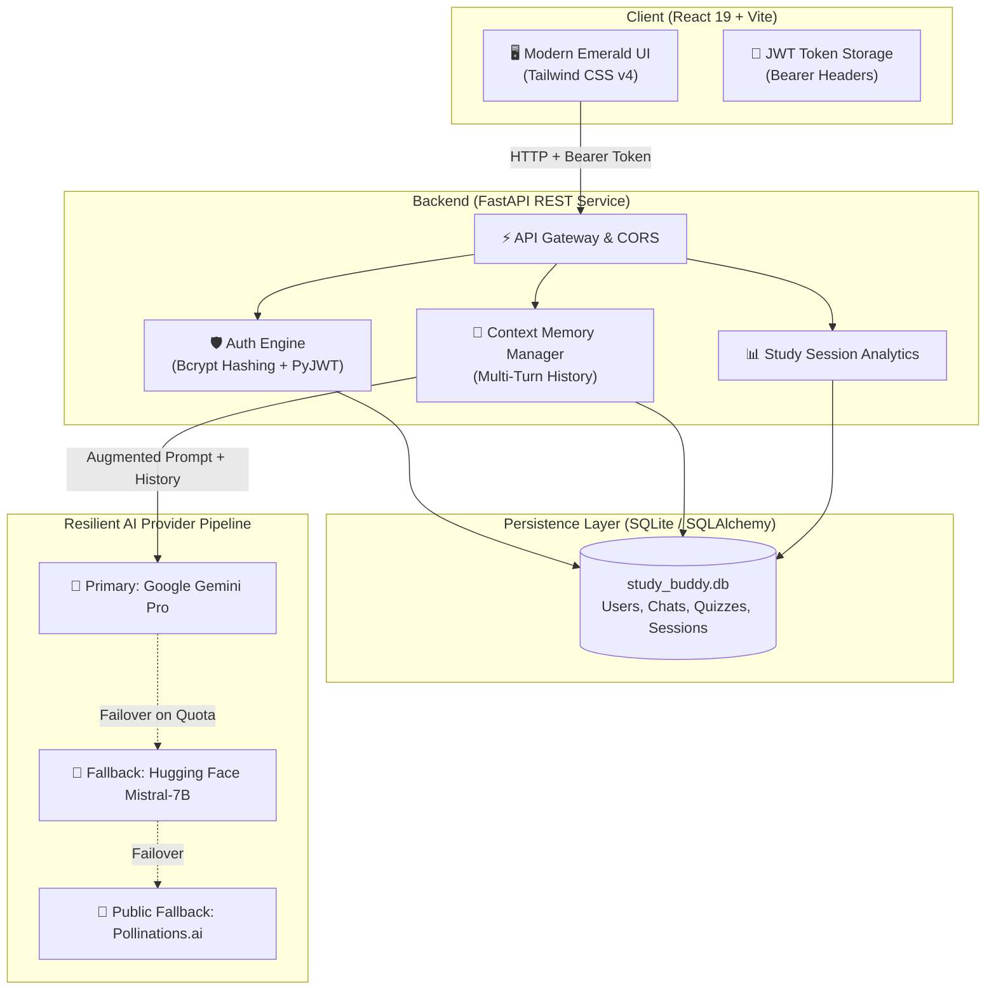

# 🎓 AI Study Buddy
> **Your Intelligent, AI-Powered Learning Companion & Study Ecosystem.**
> *A full-stack modern learning platform featuring context-aware AI tutoring, dynamic quizzes, concept mapping, and secure JWT authentication.*

[](https://fastapi.tiangolo.com/)
[](https://react.dev/)
[](https://tailwindcss.com/)
[](https://ai.google.dev/)
[](https://pyjwt.readthedocs.io/)
[](LICENSE)

---

## 🌟 Overview

**AI Study Buddy** is an end-to-end full-stack educational web application designed to help students master complex subjects faster while reducing cognitive load. It pairs a **React 19 + Tailwind CSS v4** glassmorphic frontend with a robust **FastAPI & SQLite** backend, orchestrated by **Google Gemini** generative AI with automatic fallback failover.

---

## 🏛️ System Architecture



---

## 💎 Core Features

### 🔹 Intelligent Learning Suite
* **🤖 Context-Aware AI Chat Tutor**: Remembers recent conversation history per user, providing personalized, grounded explanations rather than isolated responses.
* **📝 Instant Topic Summarizer**: Synthesizes lengthy academic articles or topics into clear, key bullet points in seconds.
* **⚡ Smart MCQ Quiz Generator**: Dynamically crafts 10-question multiple-choice quizzes with instant grading, correct answer validation, and explanations.
* **🃏 Digital Flashcard Engine**: Generates question-answer flashcard decks for active recall and spaced repetition.
* **🗺️ Concept Map Generator**: Visualizes relationships between conceptual ideas using dynamic NetworkX node graphs.

### 🔹 Security & Productivity
* **🔒 JWT Authentication**: Secure user registration and login with salt-based password hashing (`bcrypt`) and bearer token verification (`PyJWT`).
* **⏱️ Pomodoro Focus Timer**: Built-in study timer tracking real focused seconds and study streaks.
* **📊 Analytics Dashboard**: User-isolated study session statistics, total study hours, and quiz performance metrics.
* **🛡️ Triple-Layer AI Failover**: If Gemini encounters API quota limitations (`429`), the service automatically cascades to Hugging Face or public inference without crashing the user session.

---

## 🔌 API Reference

| Method | Endpoint | Description | Auth Required |
| :--- | :--- | :--- | :---: |
| `POST` | `/api/auth/register` | Create a new user account with hashed password | No |
| `POST` | `/api/auth/login` | Authenticate and obtain a JWT access token | No |
| `GET` | `/api/auth/me` | Fetch currently authenticated user profile | Yes (Bearer) |
| `POST` | `/api/chat` | Send message to AI assistant (context-aware memory) | Optional |
| `DELETE` | `/api/chat` | Clear user chat history | Optional |
| `POST` | `/api/summarize` | Generate topic summary | No |
| `POST` | `/api/generate-quiz` | Generate 10-question MCQ quiz | Optional |
| `POST` | `/api/generate-flashcards` | Generate active recall flashcards | No |
| `POST` | `/api/generate-map` | Generate concept map diagram | No |
| `POST` | `/api/track-activity` | Record study or quiz session duration | Optional |
| `GET` | `/api/progress` | Retrieve study hours, quizzes taken, and streak days | Optional |
| `GET` | `/api/analytics/dashboard` | Generate visual study activity chart | Optional |

Interactive Swagger documentation is available at `http://127.0.0.1:8000/docs`.

---

## 🛠️ Tech Stack

* **Frontend**: React 19, Vite, Tailwind CSS v4, Lucide React Icons, React Router v7.
* **Backend**: FastAPI, Uvicorn (ASGI), SQLAlchemy ORM, Pydantic v2.
* **Authentication**: PyJWT, Bcrypt password hashing.
* **AI & Data**: Google Gemini API, Hugging Face Hub, Matplotlib, NetworkX, Pandas.
* **Database**: SQLite (`study_buddy.db`).

---

## 📦 Installation & Setup

### Prerequisites
* **Node.js**: v18+
* **Python**: v3.10+
* **Git**

### 1. Clone the Repository
```bash
git clone https://github.com/Arjit005/AI_Powered_StudyBuddy.git
cd AI_Powered_StudyBuddy
```

### 2. Environment Configuration
Create a `.env` file in the project root:
```env
GEMINI_API_KEY=your_gemini_api_key_here
JWT_SECRET_KEY=your_secure_random_jwt_secret_here
# Optional fallbacks
HUGGINGFACE_API_KEY=your_huggingface_api_key_here
```

### 3. Backend Setup
```bash
# Create and activate virtual environment
python -m venv .venv

# On Windows:
.venv\Scripts\activate
# On macOS/Linux:
# source .venv/bin/activate

# Install dependencies
pip install -r backend/requirements.txt
```

### 4. Frontend Setup
```bash
npm install
```

### 5. Running the Application
* **Start Backend Server:**
  ```bash
  uvicorn backend.main:app --reload --port 8000
  ```
* **Start Frontend Dev Server:**
  ```bash
  npm run dev
  ```
Open `http://localhost:5173` in your browser.

---

## 📄 License
This project is open-source under the [MIT License](LICENSE).

